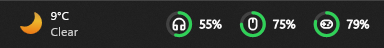

# BatteryTray

A tiny Windows 11 utility that shows the battery level of wireless peripherals **right on the taskbar** — next to the weather widget, styled like a native part of the shell.


## Supported devices

| Device | Connection | How it's read |
|---|---|---|
| **JBL Quantum350 Wireless** headset | 2.4 GHz dongle (`0ECB:206B`) | HID feature reports: `0x68` = link state, `0x49` = battery % |
| **ATK X1 Ultimate** mouse (Compx chipset) | 8K dongle (`373B:11D9`) | Vendor HID report `0x08`, command `0x04` → level, charging flag, voltage |
| **Xbox Wireless Controller** | Bluetooth | Battery value Windows keeps for paired devices (same as *Settings → Bluetooth & devices*) |

Devices that are turned off show **Off**; the Xbox controller is hidden while it's disconnected and appears as soon as it connects. A bolt icon appears while a device is charging.



## Styles

Pick a look from the right‑click menu → **Style**. It's remembered across restarts.

| Windows 11 | Modern | Classic |
|---|---|---|
|  |  |  |

- **Windows 11** — thin Fluent progress ring in the system accent color.
- **Modern** — glassy capsules with a gradient level bar (amber/rose when low, green while charging).
- **Classic** — bolder green ring, red when low.

All styles follow the system light/dark theme.

## Features

- Embedded into the taskbar itself (not the notification area), placed right after the Widgets/weather button; falls back to the left edge if the weather widget is off.
- Survives Explorer restarts — the widget is re‑attached automatically.
- Right‑click menu: **Refresh now**, **Auto‑refresh every** 1–30 minutes, **Start with Windows**, **Style**, **Exit**.
- Bluetooth devices (and anything showing *Off*) are re‑checked every 20 s, so a device appears soon after you turn it on.
- Hover a device for a tooltip with details (e.g. mouse voltage).
- Every device read has a 5 s timeout, so a stuck dongle can't freeze the widget.
- Autostart uses a shortcut in the Startup folder, so it can also be toggled in *Task Manager → Startup apps*.
- Errors never pop up dialogs; they are logged to `%LOCALAPPDATA%\BatteryTray\errors.log`.

## Requirements

- Windows 11
- [.NET 9 SDK](https://dotnet.microsoft.com/download/dotnet/9.0) (to build) or .NET 9 Desktop Runtime (to run)

## Build & run

```powershell
cd BatteryTray
dotnet build -c Release
.\bin\Release\net9.0-windows\BatteryTray.exe
```

Only one instance runs at a time.

### Troubleshooting

Write one reading per device to a file and exit:

```powershell
BatteryTray.exe --test readings.txt
```

## Adding a device

Implement `IBatteryDevice` (see [`Devices.cs`](BatteryTray/Devices.cs)) — return a `BatteryReading` with the percentage, charging flag and a detail string — give it a Segoe Fluent Icons `Glyph`, and add it to `Devices.All` in the same file.

## Project structure

| File | Purpose |
|---|---|
| `Program.cs` | Entry point, polling (`BatteryApp`, `DeviceReader`), context menu |
| `Devices.cs` | Device model (`BatteryReading`, `DeviceStatus`, `Devices.All`), headset and mouse readers |
| `Bluetooth.cs` | Bluetooth battery properties, Xbox controller |
| `Hid.cs`, `SetupApi.cs` | Minimal Win32 HID / SetupAPI helpers |
| `TaskbarWidget.cs` | Layered window embedded in the taskbar |
| `WeatherAnchor.cs` | Finds the weather button to place the widget next to |
| `Skin.cs` | The styles table and the renderer interface |
| `ItemView.cs` | What is shown per device (value, charging, low) |
| `RingRenderer.cs`, `CapsuleRenderer.cs` | Drawing of the ring styles (Windows 11, Classic) and Modern |
| `WidgetPainter.cs` | Shared drawing: frame, value text, bolt, icons |
| `Theme.cs` | System light/dark and accent color, ring palettes |
| `FluentMenu.cs` | Windows 11 styling of the context menu |
| `Settings.cs`, `Autostart.cs` | Saved settings, Startup-folder shortcut |

## Disclaimer

This project is not affiliated with, endorsed by, or sponsored by JBL or ATK. All product names are trademarks of their respective owners.
